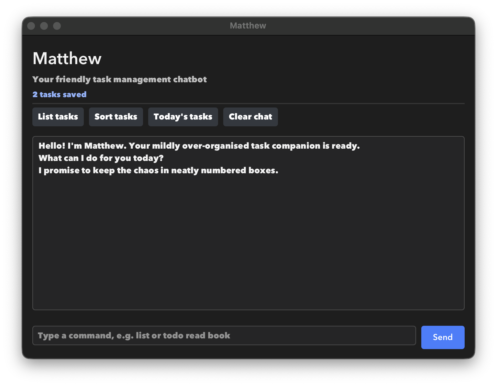

# Matthew User Guide



Matthew is a friendly, mildly over-organised task manager for keeping todos,
deadlines, and events in one place. Commands are saved automatically in
`data/matthew.txt`.

## Quick start

Run the GUI with:

```text
java -jar matthew.jar
```

Type a command in the input box and press **Enter** or **Send**. The quick
action buttons above the conversation run common read-only commands for you.

## Commands

### Add a todo

```text
todo DESCRIPTION
```

Example: `todo buy groceries`

### Add a deadline

```text
deadline DESCRIPTION /by yyyy-MM-dd HHmm
```

Example: `deadline submit report /by 2026-09-20 1800`

### Add an event

```text
event DESCRIPTION /from yyyy-MM-dd HHmm /to yyyy-MM-dd HHmm
```

Example: `event project meeting /from 2026-09-18 1400 /to 2026-09-18 1600`

### View and search tasks

- `list` displays tasks in their saved order.
- `sort` displays tasks alphabetically without changing their saved order.
- `find KEYWORD` displays tasks whose descriptions contain `KEYWORD`,
  ignoring letter case.
- `on yyyy-MM-dd` displays deadlines and events occurring on that date.

### Update tasks

- `mark NUMBER` marks a task as done.
- `unmark NUMBER` marks a task as not done.
- `delete NUMBER` removes a task.

Task numbers are one-based and follow the order shown by `list`.

### Exit

Use `bye` to close Matthew. Closing the GUI window also exits the application.

## Helpful behaviour

Matthew reports malformed commands, invalid dates, missing task numbers, and
corrupted saved data without crashing. If the saved data cannot be loaded, the
application starts with an empty task list and explains what happened.

The **Clear chat** button resets only the visible conversation; it does not
delete saved tasks.
